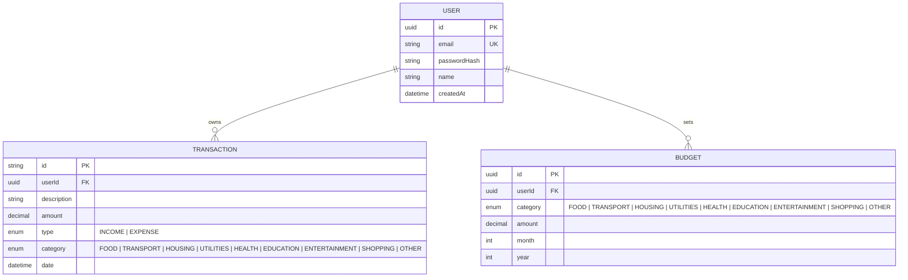

# 💰 FinTrack — Personal Finance Tracker

[](https://www.typescriptlang.org/)
[](https://react.dev/)
[](https://tailwindcss.com/)
[](https://expressjs.com/)
[](https://www.postgresql.org/)
[](https://www.prisma.io/)

A modern, responsive, full-stack Personal Finance Web Application built for high security, precision financial tracking, and intuitive user experience.

---

## 🌟 Key Features

- **🔐 Robust Authentication & Security**:
  - Secure authentication with `bcrypt` (12 rounds) and `JWT` delivered via **HttpOnly cookies** (preventing XSS access).
  - Server-side input validation on every route using **Zod**.
  - Security hardening via **Helmet**, **CORS**, and granular **Rate Limiting** (anti brute-force).
  - Financial amounts are strictly stored as PostgreSQL `Decimal` types to eliminate floating-point rounding errors.
- **💸 Transaction Management**:
  - Record, categorize, and delete income and expense transactions.
  - Multi-parameter **Search & Filtering** (search by keyword, filter by income/expense, or by category).
  - Server-side **Pagination** for optimal performance.
  - One-click **Export to CSV** (encoded with UTF-8 BOM for Microsoft Excel compatibility).
- **📊 Budgeting & Spending Warnings**:
  - Monthly category budgeting with automatic tracking of actual spending.
  - **Dynamic Spending Warnings**:
    - 🟢 **Normal (< 80%)**: Safe spending progress.
    - 🟠 **Near Limit (80% - 99%)**: Proactive warning before exceeding budget.
    - 🔴 **Exceeded (>= 100%)**: Critical alert showing the exact amount over budget.
- **📈 Visual Analytics & Reports**:
  - Interactive charts powered by **Recharts** (Income vs. Expense bar & pie charts).
  - **Category Spending Breakdown** donut chart with color palettes and percentage distribution.
- **🎨 UI / UX Excellence**:
  - Dark Mode and Light Mode support with smooth transitions.
  - Multi-language support (English and Thai `i18n`).
  - Fluid micro-animations with **Framer Motion**.

---

## 🗄️ Database Architecture & ER Diagram



---

## 🛠️ Tech Stack

### Frontend
- **Framework**: React 19 + Vite
- **Language**: TypeScript
- **Styling**: Tailwind CSS v4
- **Routing**: `react-router-dom` v7
- **Data Visualization**: Recharts
- **Internationalization**: `i18next` + `react-i18next` (English & Thai)
- **Icons & Animation**: Lucide React + Framer Motion

### Backend
- **Runtime**: Node.js + Express
- **Language**: TypeScript (`tsx` runner)
- **Database**: PostgreSQL (Serverless Neon DB)
- **ORM**: Prisma ORM v7 with `@prisma/adapter-pg`
- **Validation**: Zod
- **Security**: `helmet`, `cors`, `express-rate-limit`, `cookie-parser`, `bcrypt`, `jsonwebtoken`
- **Testing**: Vitest + Supertest

---

## 📡 API Overview

| Method | Endpoint | Description | Auth Required |
|:---|:---|:---|:---:|
| `POST` | `/api/auth/register` | Register a new user | ❌ |
| `POST` | `/api/auth/login` | Login and obtain HttpOnly cookie | ❌ |
| `POST` | `/api/auth/logout` | Clear authentication cookie | ✅ |
| `GET` | `/api/auth/me` | Fetch authenticated user profile | ✅ |
| `GET` | `/api/transactions` | Query transactions (supports `search`, `type`, `category`, `page`, `limit`) | ✅ |
| `POST` | `/api/transactions` | Create a new transaction | ✅ |
| `DELETE`| `/api/transactions/:id` | Delete a transaction owned by user | ✅ |
| `GET` | `/api/budgets` | Fetch budgets with aggregated `spent` amount | ✅ |
| `POST` | `/api/budgets` | Set or update a category budget | ✅ |
| `DELETE`| `/api/budgets/:id` | Remove a category budget | ✅ |

---

## 🚀 Getting Started Locally

### Prerequisites
- Node.js (v20+ recommended)
- PostgreSQL database URL (e.g., Neon PostgreSQL)

### 1. Clone the repository
```bash
git clone <repository-url>
cd Pro1
```

### 2. Configure Environment Variables
Inside `backend/.env`:
```env
DATABASE_URL="postgresql://<user>:<password>@<host>/<dbname>?sslmode=require"
JWT_SECRET="your-super-secret-key-at-least-32-characters"
FRONTEND_ORIGIN="http://localhost:5173"
PORT=3001
NODE_ENV="development"
```

### 3. Setup Backend
```bash
cd backend
npm install
npx prisma generate
npx prisma migrate dev
npm run dev
```

### 4. Setup Frontend
```bash
cd ../frontend
npm install
npm run dev
```

The frontend will run on `http://localhost:5173` and backend on `http://localhost:3001`.

---

## ☁️ Deployment Guide

### Frontend -> Vercel
1. Connect your GitHub repository to [Vercel](https://vercel.com).
2. Set **Root Directory** to `frontend`.
3. Add environment variable:
   - `VITE_API_URL`: Your deployed backend URL (e.g., `https://fintrack-api.onrender.com/api`).
4. Deploy!

### Backend -> Render / Railway
1. Create a new **Web Service** on [Render](https://render.com) or [Railway](https://railway.app).
2. Set **Root Directory** to `backend`.
3. Build Command: `npm install && npx prisma generate && npx prisma migrate deploy`
4. Start Command: `npm start` (or `npx tsx src/index.ts`)
5. Configure Environment Variables:
   - `DATABASE_URL`: Connection string from Neon PostgreSQL.
   - `JWT_SECRET`: Random 32+ character string.
   - `FRONTEND_ORIGIN`: Your deployed Vercel domain (e.g., `https://fintrack.vercel.app`).
   - `NODE_ENV`: `production`

---

## 👨‍💻 Developer & Internship Preparation
- Developed as a 3rd-year university software engineering project.
- Demonstrates full-stack architectural design, data isolation, relational schema modeling, and production-ready security standards.
